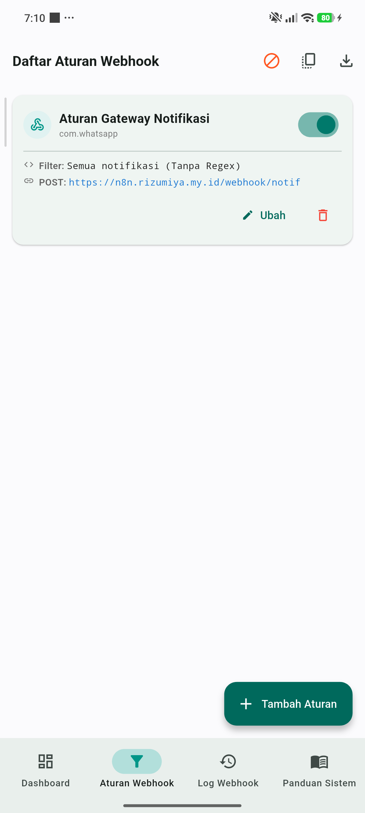
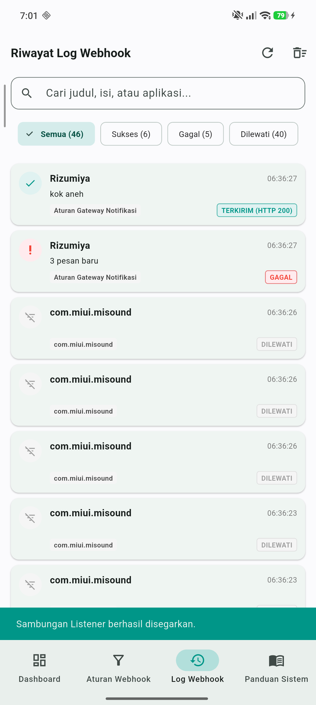
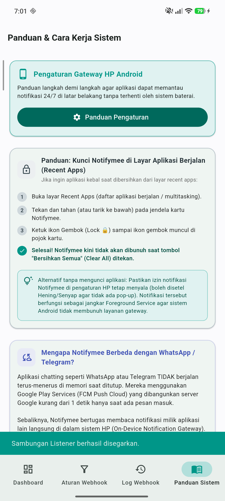
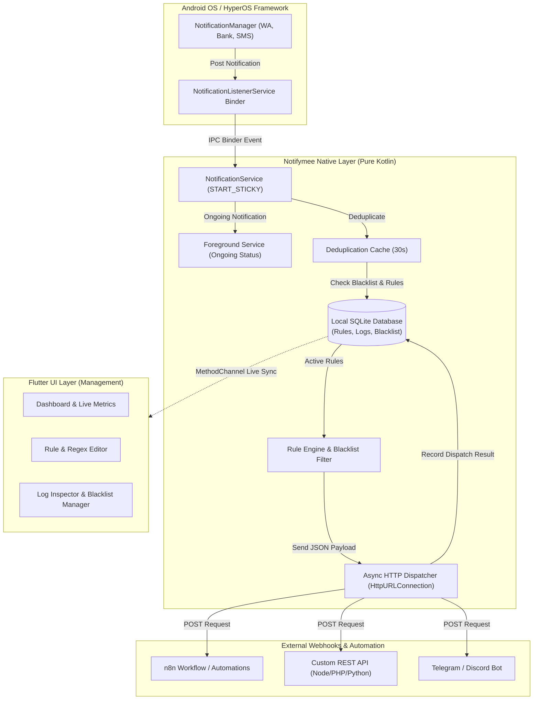

# 🚀 Notifymee (NotifyMe) — Android Notification Gateway to Webhooks

[](https://flutter.dev)
[](https://kotlinlang.org)
[](https://developer.android.com)
[](LICENSE)
[](#arsitektur-tahan-banting-persistent)

**Notifymee** adalah gateway notifikasi Android modern dan berkinerja tinggi yang menangkap notifikasi perangkat secara *real-time* dan meneruskannya ke *webhook server*, n8n, Zapier, Make, Telegram bot, atau REST API backend kustom Anda.

Dibangun dengan arsitektur **Pure Native Interception (Kotlin)** dan antarmuka manajemen modern berbasis **Flutter Material 3**, Notifymee dirancang agar **tahan banting (persistent)** dan tetap beroperasi di latar belakang bahkan saat aplikasi ditutup atau dibersihkan dari layar *Recent Apps*.

---

## 📸 Tampilan Antarmuka (Screenshots)

<div align="center">
  <table>
    <tr>
      <td align="center"><b>Dashboard & Status Gateway</b></td>
      <td align="center"><b>Aturan Filter Webhook</b></td>
    </tr>
    <tr>
      <td></td>
      <td></td>
    </tr>
    <tr>
      <td align="center"><b>Riwayat Log & Blacklist Kata Kunci</b></td>
      <td align="center"><b>Panduan Setup & OEM Resilience</b></td>
    </tr>
    <tr>
      <td></td>
      <td></td>
    </tr>
  </table>
</div>

---

## ⚡ Fitur Utama (Core Features)

- 🔒 **Arsitektur Pure Native (Kotlin) Tahan Banting**: Logika penerimaan notifikasi (`NotificationListenerService`), pencocokan filter, dan pengiriman HTTP POST berjalan 100% di sisi Native Android (Kotlin). Webhook tetap terkirim meskipun Main Flutter Activity / UI dimatikan oleh sistem.
- 🎯 **Rule Engine & Regex Filter**:
  - Filter berdasarkan aplikasi (`package_name`) atau semua aplikasi.
  - Filter teks menggunakan pola RegEx fleksibel dengan *Named Capture Groups*.
  - Ekstraksi otomatis token OTP, nominal transfer bank, status order, dan pesan sensitif.
- 🚫 **Per-Package Keyword Blacklist / Exclude**:
  - Fitur sekali klik langsung dari lembar detail log untuk mem-blacklist status berkala (contoh: WhatsApp *"Memeriksa pesan baru"*).
  - Khusus per aplikasi, tanpa mempengaruhi notifikasi penting lainnya.
- 💬 **WhatsApp Multi-Message Auto-Extractor**:
  - Secara cerdas membedah tumpukan notifikasi pesan WhatsApp (`MessagingStyle`) menjadi entri obrolan individual, lengkap dengan pencegah duplikasi (*Deduplication Cache*).
- 🔄 **Auto-Rebind & Anti-Kill Engine**:
  - Implementasi `onTaskRemoved` dan `onDestroy` dengan `requestRebind(ComponentName)`.
  - Terintegrasi dengan Foreground Service (`START_STICKY`) dan `FOREGROUND_SERVICE_SPECIAL_USE` (Android 14+ / HyperOS).
  - *Safety resurrection alarm* menggunakan `AlarmManager` jika sistem OEM mencoba membunuh proses.
- 💾 **Penyimpanan Offline SQLite Terbuka**:
  - Aturan filter, riwayat pengiriman, payload JSON, dan blacklist disimpan di SQLite lokal yang diakses bersama oleh Flutter dan Kotlin.
- 🌐 **Bilingual (Indonesian & English)**:
  - Tersedia tombol cepat ganti bahasa langsung di AppBar tanpa harus membuka pengaturan perangkat.

---

## 🏗️ Diagram Arsitektur Sistem



---

## 📡 Format Payload JSON Universal

Setiap notifikasi yang cocok dengan aturan akan dikirimkan ke URL Webhook target dengan *HTTP POST (application/json)*:

```json
{
  "event": "notification_received",
  "timestamp": 1793983285397,
  "datetime": "2026-11-06T23:41:25.397+0700",
  "app": {
    "package_name": "com.whatsapp",
    "app_name": "WhatsApp"
  },
  "notification": {
    "title": "Budi Santoso",
    "text": "Halo, transfer sudah dikirim ya!",
    "big_text": "Halo, transfer sudah dikirim ya! Cek mutasi Rp 500.000",
    "sub_text": "",
    "full_content": "Budi Santoso Halo, transfer sudah dikirim ya!",
    "is_group_summary": false
  },
  "rule": {
    "id": "rule_01_wa",
    "name": "Penerus Notifikasi WhatsApp"
  },
  "matches": {
    "has_regex": true,
    "regex_pattern": "transfer.*?Rp\\s*(?<nominal>[\\d.]+)",
    "groups": [
      {
        "name": "nominal",
        "value": "500.000"
      }
    ]
  }
}
```

---

## 🛡️ Panduan Ketahanan Latar Belakang (OEM Resilience)

### Mengapa Notifymee Berbeda dengan WhatsApp / Telegram?
- **WhatsApp / Telegram**: Tidak perlu berjalan 24 jam di RAM saat ditutup. Mereka menggunakan **Google Play Services (FCM Push Cloud)** yang membangunkan aplikasi selama kurang dari 1 detik hanya saat server Google memberi tahu ada pesan baru.
- **Notifymee**: Merupakan **On-Device Gateway**. Tidak ada server cloud manapun yang mengetahui apa notifikasi yang muncul di layar HP Anda. Oleh karena itu, Notifymee **wajib** mempertahankan koneksi Binder lokal (`NotificationListenerService`) secara terus-menerus di memori.

### Cara Menjaga Notifymee Berjalan 24/7 di Xiaomi / HyperOS / MIUI / Oppo / Vivo:
1. **Izinkan Notifikasi Notifymee**: Jangan matikan notifikasi aplikasi Notifymee di Pengaturan HP. Jika tidak ingin notifikasi mengganggu bilah status, ubah ke **Hening / Senyap (Silent)**. Notifikasi ini adalah jangkar *Foreground Service* agar sistem Android tidak mematikan service saat Recent Apps disapu.
2. **Kunci Notifymee di Layar Recent Apps**:
   - Buka layar *Recent Apps* (multitasking).
   - Tekan dan tahan (atau geser ke bawah) pada jendela kartu Notifymee.
   - Ketuk ikon **Gembok (Lock 🔒)**.
3. **Mulai Otomatis (Autostart)**: Buka *Info Aplikasi* -> aktifkan *Mulai Otomatis (Autostart)*.
4. **Penghemat Baterai**: Pilih **Tidak ada pembatasan (No restrictions)**.

---

## 🛠️ Contoh Webhook Handler Server

### 1. Node.js (Express)
```javascript
const express = require('express');
const app = express();
app.use(express.json());

app.post('/webhook/notifications', (req, res) => {
  const { event, app: sourceApp, notification, rule, matches } = req.body;
  
  console.log(`[${sourceApp.app_name}] ${notification.title}: ${notification.text}`);
  
  if (matches.has_regex) {
    console.log("Matched Groups:", matches.groups);
  }

  res.status(200).json({ status: 'ok', received_at: new Date().toISOString() });
});

app.listen(3000, () => console.log('Webhook server running on port 3000'));
```

### 2. Python (FastAPI)
```python
from fastapi import FastAPI, Request
import uvicorn

app = FastAPI()

@app.post("/webhook/notifications")
async def receive_notification(request: Request):
    payload = await request.json()
    app_info = payload.get("app", {})
    notif = payload.get("notification", {})
    
    print(f"[{app_info.get('app_name')}] {notif.get('title')}: {notif.get('text')}")
    return {"status": "success"}

if __name__ == "__main__":
    uvicorn.run(app, host="0.0.0.0", port=8000)
```

### 3. PHP
```php
<?php
header('Content-Type: application/json');

$input = file_get_contents('php://input');
$data = json_decode($input, true);

if ($data) {
    $appName = $data['app']['app_name'] ?? 'Unknown';
    $title = $data['notification']['title'] ?? '';
    $text = $data['notification']['text'] ?? '';
    
    file_put_contents('notifications.log', date('c') . " - [$appName] $title: $text\n", FILE_APPEND);
    echo json_encode(['status' => 'success']);
} else {
    http_response_code(400);
    echo json_encode(['status' => 'invalid_json']);
}
```

---

## 📦 Cara Membangun dari Source Code

### Prasyarat
- Flutter SDK 3.24+
- Android SDK 34 / 35
- Java 17

### Perintah Build
```bash
# Clone repository
git clone https://github.com/rizumiya/notifymee.git
cd notifymee

# Unduh dependencies Flutter
flutter pub get

# Jalankan unit & widget tests
flutter test

# Build APK Debug (Khusus ARM64)
flutter build apk --target-platform android-arm64 --debug

# Install ke perangkat via ADB
adb install -r -d build/app/outputs/flutter-apk/app-debug.apk
```

---

## 📄 Lisensi

Proyek ini dirilis di bawah lisensi [MIT](LICENSE). Bebas digunakan, dimodifikasi, dan didistribusikan untuk keperluan pribadi maupun komersial.
