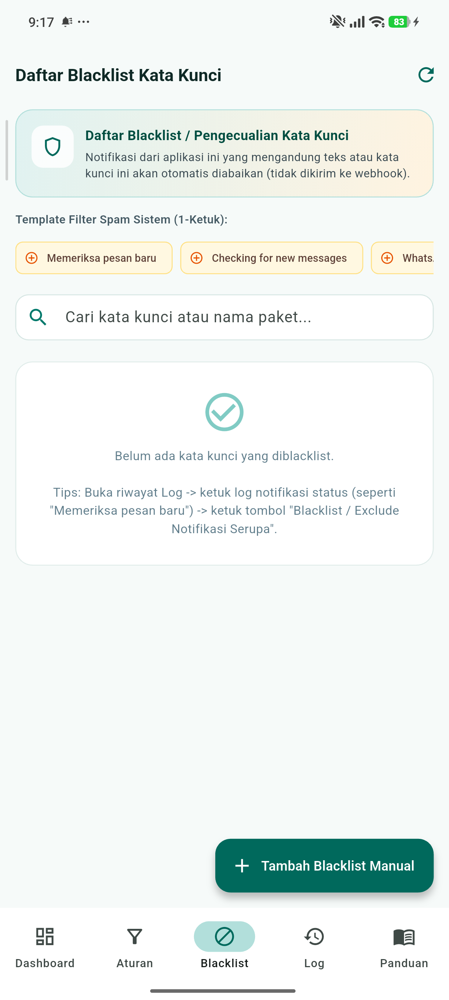
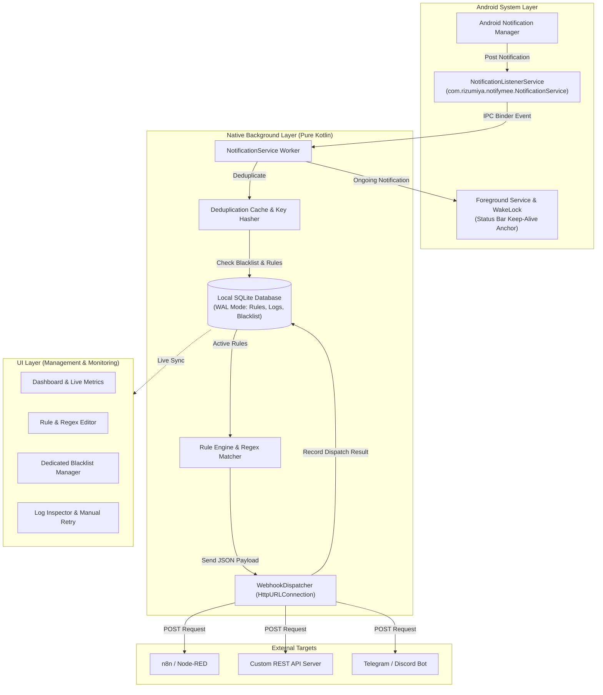

# 🚀 Notifymee — Android Notification Gateway to Webhooks

<div align="center">
  <p>
    <b>🇬🇧 English</b> &nbsp;|&nbsp; <a href="README.id.md">🇮🇩 Bahasa Indonesia</a>
  </p>
</div>

[](https://flutter.dev)
[](https://kotlinlang.org)
[](https://developer.android.com)
[](LICENSE)
[](#persistent-background-architecture)

**Notifymee** is a resilient, modern Android notification gateway that captures incoming device notifications in real time and forwards them to your target webhook servers, n8n, Zapier, Make, Telegram bots, or custom backend APIs.

Built with a **Pure Native Interception (Kotlin)** architecture paired with a slick **Flutter Material 3** management UI, Notifymee is engineered to stay persistently active 24/7 in the background—even after the app is cleared or swiped away from the Recent Apps screen.

---

## 📸 App Screenshots

<div align="center">
  <table>
    <tr>
      <th width="33.3%" align="center">Dashboard & Gateway Status</th>
      <th width="33.3%" align="center">Rules & Webhook Editor</th>
      <th width="33.3%" align="center">Keyword Blacklist & Anti-Spam</th>
    </tr>
    <tr>
      <td align="center"></td>
      <td align="center"></td>
      <td align="center"></td>
    </tr>
  </table>

  <table>
    <tr>
      <th width="50%" align="center">Dispatch Logs & Manual Retry</th>
      <th width="50%" align="center">Setup Guide & OEM Resilience</th>
    </tr>
    <tr>
      <td align="center"></td>
      <td align="center"></td>
    </tr>
  </table>
</div>

### 📂 Ready-to-Use Config Presets ([`/presets/`](presets/))
Pre-configured JSON rule & blacklist bundles ready for 1-click import:
- 💬 [**`whatsapp_chat_dan_antispam.json`**](presets/whatsapp_chat_dan_antispam.json) — WhatsApp chat forwarding with auto-blacklist for system status notifications (*"Checking for new messages"*, *"Backing up chats"*, etc.).
- 💳 [**`mutasi_qris_dana_bca_gopay.json`**](presets/mutasi_qris_dana_bca_gopay.json) — Bank & e-wallet transaction parser with transfer amount regex extraction.
- 🔑 [**`otp_verifikasi_universal.json`**](presets/otp_verifikasi_universal.json) — Universal regex rule to catch 4–8 digit OTP codes from SMS & banking apps.
- 🤖 [**`telegram_bot_gateway.json`**](presets/telegram_bot_gateway.json) — Direct webhook forwarding configured for Telegram Bot APIs.

---

## ⚡ Core Features

- 🔒 **Persistent Pure Native (Kotlin) Architecture**:
  Notification listening (`NotificationListenerService`), filter matching, SQLite caching, and HTTP POST dispatching run 100% in Native Android (Kotlin). Webhooks continue firing without delay even when Flutter UI activities are killed.
- 🎯 **Rule Engine with Flexible RegEx**:
  - Filter by specific application package name (`com.whatsapp`, `com.bank.bca`) or wildcards (`*`).
  - Powerful RegEx support with *Named Capture Groups* (`(?<amount>...)`) and indexed capture groups forwarded directly in the JSON payload.
  - Automatically extracts OTP codes, bank mutation balances, order numbers, and transaction IDs.
- 🚫 **Dedicated Keyword Blacklist & Anti-Spam Manager**:
  - Independent navigation tab for keyword exclusions per-package or globally (`*`).
  - **1-Tap Spam Filter Templates** to instantly ignore transient system popups (*"Checking for new messages"*, *"WhatsApp Web active"*, etc.).
- 📦 **Export & Import Package Configurations (Custom File Names)**:
  - Backup rules and blacklists together as a unified bundle `.json` with customizable filenames.
  - Share and import pre-built setups across multiple devices seamlessly.
- 💬 **WhatsApp Multi-Message Auto-Extractor**:
  - Intelligently parses bundled `MessagingStyle` group notifications into individual chat events with an in-memory *Deduplication Cache*.
- 🔄 **Keep-Alive & Auto-Rebind Engine**:
  - Implements `onTaskRemoved` and `onDestroy` lifecycle handlers that call `requestRebind(ComponentName)` to ensure the system listener immediately reconnects if dismissed.
  - Coupled with a sticky Foreground Service (`START_STICKY`), `PARTIAL_WAKE_LOCK` for deep sleep (*Doze Mode*), and Android 14+ / HyperOS compliance (`FOREGROUND_SERVICE_SPECIAL_USE`).
  - **Double-back-to-exit** confirmation prevents accidental closure of the UI.
- 💾 **Local Offline SQLite Database (WAL Mode)**:
  - Rules, dispatch logs, payloads, and blacklists are persisted safely in SQLite with Write-Ahead Logging (`WAL`), allowing concurrent access from native background threads and Flutter UI.
- 🌐 **Bilingual (English & Indonesian)**:
  - Built-in dynamic language switcher in the AppBar without requiring app restarts.

---

## 🏗️ Architecture & Data Flow



---

## 📡 Universal JSON Payload Format

Every notification that matches an active rule is delivered to the configured Webhook URL via *HTTP POST (application/json)*:

```json
{
  "event": "notification_received",
  "timestamp": 1793983285397,
  "datetime": "2026-11-06T23:41:25.397+0700",
  "app": {
    "package_name": "com.whatsapp",
    "app_name": "WhatsApp"
  },
  "notification": {
    "title": "Budi Santoso",
    "text": "Payment sent! Reference ID: TRX-9921",
    "big_text": "Payment sent! Reference ID: TRX-9921. Total: $500.00",
    "sub_text": "",
    "full_content": "Budi Santoso Payment sent! Reference ID: TRX-9921",
    "is_group_summary": false
  },
  "rule": {
    "id": "rule_01_wa",
    "name": "WhatsApp Forwarder"
  },
  "matches": {
    "has_regex": true,
    "regex_pattern": "Reference ID:\\s*(?<ref_id>[A-Z0-9-]+)",
    "groups": [
      {
        "name": "ref_id",
        "value": "TRX-9921"
      }
    ]
  }
}
```

---

## 🛡️ OEM Keep-Alive & Resilience Guide

### How to keep Notifymee running 24/7 on Xiaomi / HyperOS / MIUI / Oppo / Vivo:
1. **Keep Notifymee Notifications Enabled**:
   Do not block Notifymee notifications in Android system settings. If you prefer not to see the ongoing banner, set it to **Silent / Non-intrusive**. This notification acts as the critical *Foreground Service Anchor* that prevents Android from reclaiming the gateway service during memory optimization.
2. **Lock Notifymee in Recent Apps**:
   - Open your device's **Recent Apps** (multitasking screen).
   - Long-press (or swipe down) on the Notifymee window card.
   - Tap the **Padlock icon (Lock 🔒)**. Notifymee is now exempt from the "Clear All" killer.
3. **Autostart Permission**:
   Go to *App Info* -> enable **Autostart**.
4. **Battery Saver Settings**:
   Set Battery Saver to **No Restrictions (Unrestricted)**.

---

## 🛠️ Example Webhook Server Implementations

### 1. Node.js (Express)
```javascript
const express = require('express');
const app = express();
app.use(express.json());

app.post('/webhook/notifications', (req, res) => {
  const { event, app: sourceApp, notification, rule, matches } = req.body;
  
  console.log(`[${sourceApp.app_name}] ${notification.title}: ${notification.text}`);
  
  if (matches.has_regex) {
    console.log("Matched Regex Groups:", matches.groups);
  }

  res.status(200).json({ status: 'ok', received_at: new Date().toISOString() });
});

app.listen(3000, () => console.log('Webhook server running on port 3000'));
```

### 2. Python (FastAPI)
```python
from fastapi import FastAPI, Request
import uvicorn

app = FastAPI()

@app.post("/webhook/notifications")
async def receive_notification(request: Request):
    payload = await request.json()
    app_info = payload.get("app", {})
    notif = payload.get("notification", {})
    
    print(f"[{app_info.get('app_name')}] {notif.get('title')}: {notif.get('text')}")
    return {"status": "success"}

if __name__ == "__main__":
    uvicorn.run(app, host="0.0.0.0", port=8000)
```

### 3. PHP
```php
<?php
header('Content-Type: application/json');

$input = file_get_contents('php://input');
$data = json_decode($input, true);

if ($data) {
    $appName = $data['app']['app_name'] ?? 'Unknown';
    $title = $data['notification']['title'] ?? '';
    $text = $data['notification']['text'] ?? '';
    
    file_put_contents('notifications.log', date('c') . " - [$appName] $title: $text\n", FILE_APPEND);
    echo json_encode(['status' => 'success']);
} else {
    http_response_code(400);
    echo json_encode(['status' => 'invalid_json']);
}
```

---

## 📦 Building from Source

### Prerequisites
- Flutter SDK 3.24+
- Android SDK 34 / 35
- Java 17

### Build Commands
```bash
# Clone the repository
git clone https://github.com/rizumiya/notifymee.git
cd notifymee

# Fetch Flutter dependencies
flutter pub get

# Run unit and widget tests
flutter test

# Build Debug APK (ARM64 optimized)
flutter build apk --target-platform android-arm64 --debug

# Install to connected device via ADB
adb install -r -d build/app/outputs/flutter-apk/app-debug.apk
```

---

## 📄 License

This project is licensed under the [MIT License](LICENSE). Feel free to use, modify, and distribute for personal and commercial purposes.
